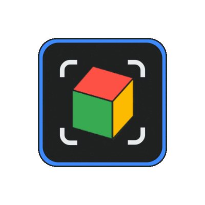
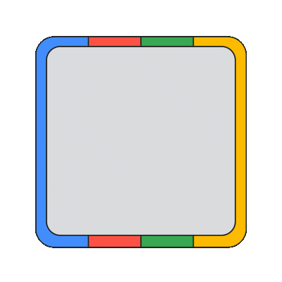

<h1 align="center">
  <samp>Hi, I'm <b>Reyhan</b> (a.k.a DEKU)</samp>
  
</h1>

  <b>Software Engineer</b> · Computer Science Student at Universitas Bhinneka PGRI

## 👨‍💻 About Me

Hello! I'm **Reyhan**, a Software Engineer based in East Java, Indonesia. I'm currently pursuing a degree in Computer Science at **Universitas Bhinneka PGRI**, where I'm building a strong foundation in software development while working on real-world projects.

I enjoy creating software of any kind, especially large systems of programs that work together. I take a calm and consistent approach to my work, because steady progress beats rushing.

## 🚀 What I Do

- 💻 Software development and building projects from scratch
- 📚 Continuously learning new tools, languages, and best practices
- 🤝 Open to collaboration, internships, and new opportunities
- 📍 East Java, Indonesia 🇮🇩

 

  

<h2><samp>Tech Stack</samp></h2>

 

<h2><samp>Tools</samp></h2>

 

  

<h1><samp>よろしくお願いします✌️</samp></h1>

